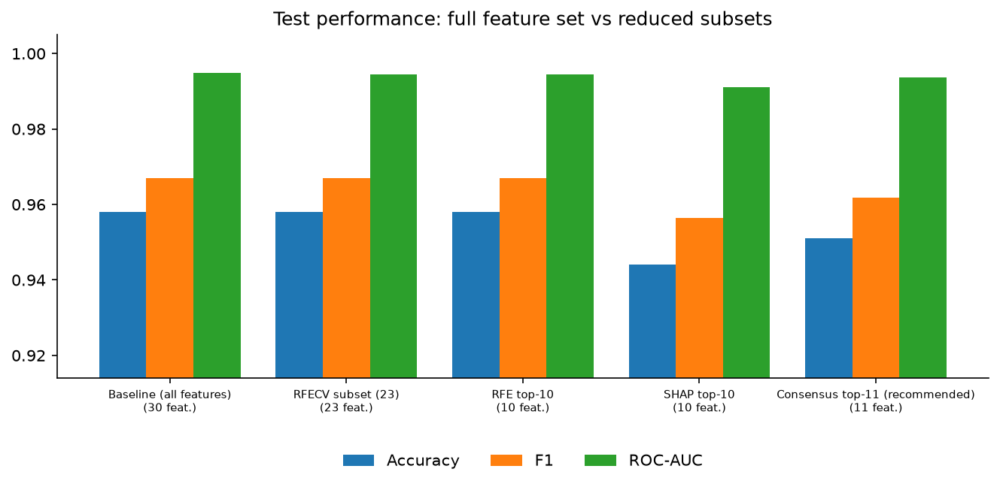
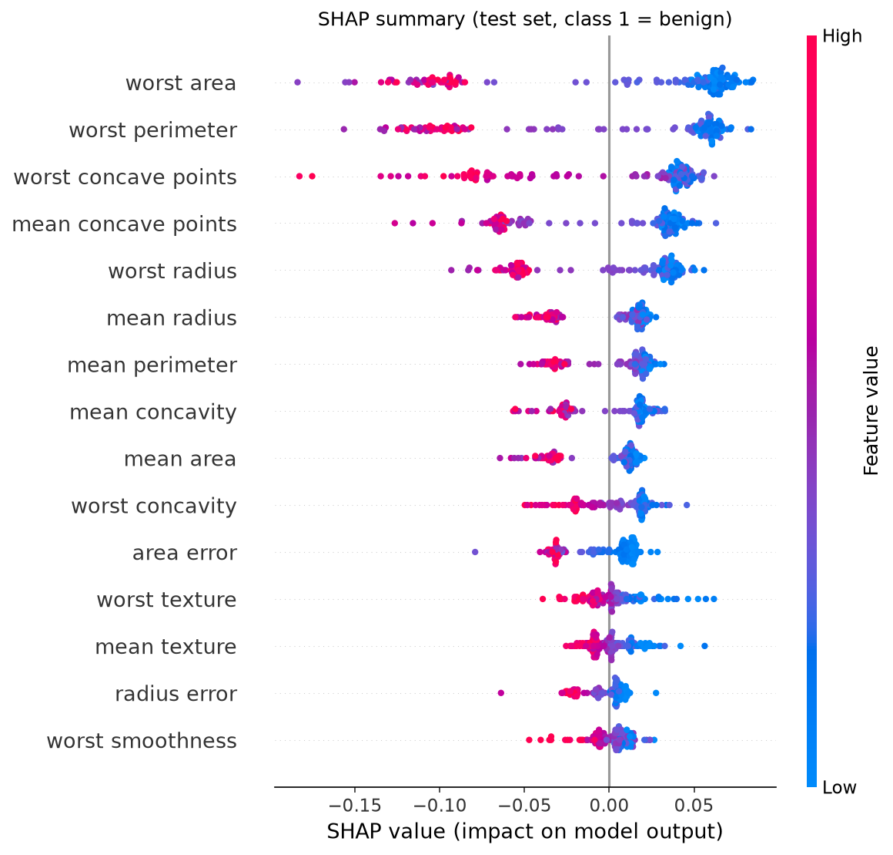
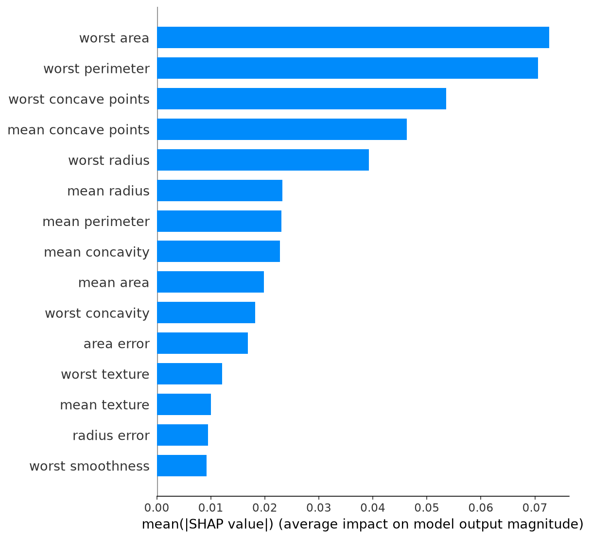
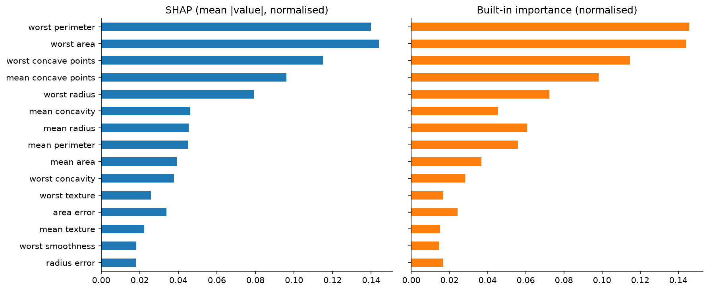
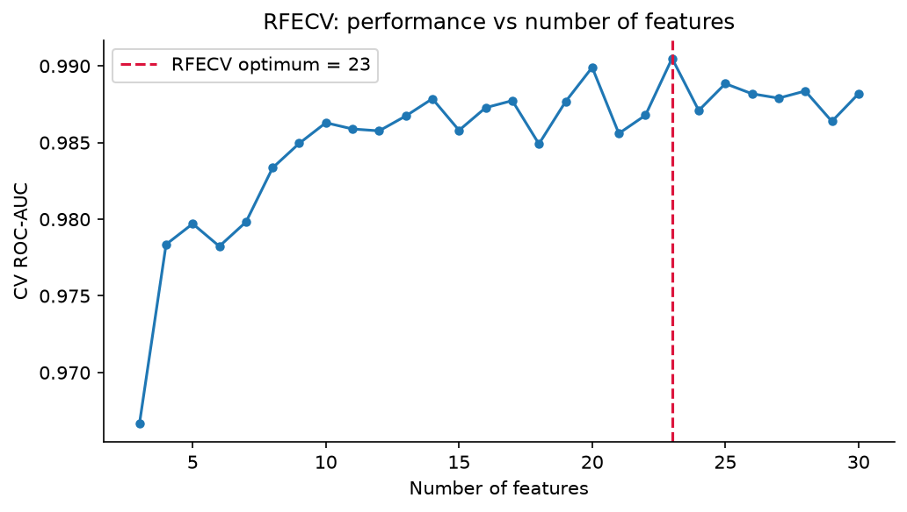
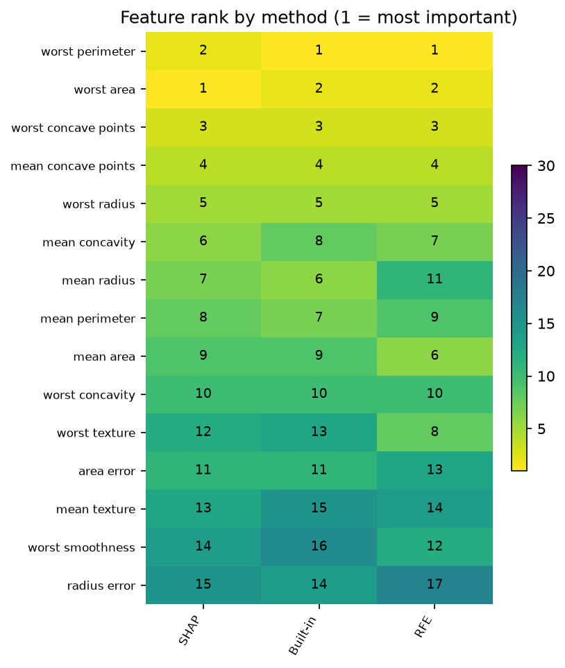
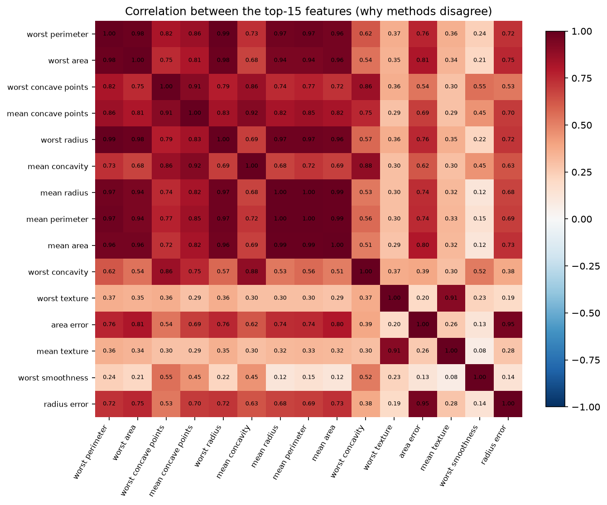
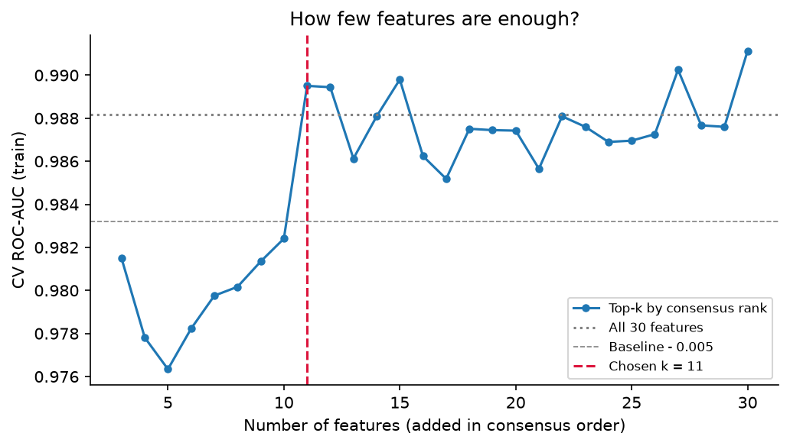

# Feature Selection: SHAP vs Built-in Importance vs RFE

Identifies the most predictive features in the Breast Cancer Wisconsin dataset (30 features)
using three methods, then verifies that a reduced feature set performs as well as the full one.

## How to run
```bash
pip install -r requirements.txt
python feature_selection.py
```
Plots and tables are written to this same folder, and the Results section below is regenerated.

## Pipeline
1. Baseline Random Forest on all features
2. SHAP values (`TreeExplainer`) with summary plots
3. Built-in `feature_importances_` compared against SHAP
4. `RFECV` for the optimal subset size, plus a full RFE elimination order
5. Retrain on each subset and compare with the baseline
6. Consensus ranking across the three methods and a final recommended feature set

<!-- RESULTS:START -->
<!-- This block is regenerated by feature_selection.py. Edit text outside the markers. -->

## Results

**Headline:** the recommended subset uses **11 of 30 features** and reaches test ROC-AUC
**0.9936** vs **0.9949** for the full model
(Δ -0.0013), with CV ROC-AUC within 0.005 of the baseline.

### 1. Baseline vs reduced models

| Model | Features | Accuracy | F1 | ROC-AUC | CV ROC-AUC (train) | Δ AUC vs baseline |
|---|---|---|---|---|---|---|
| Baseline (all features) | 30 | 0.9580 | 0.9670 | 0.9949 | 0.9882 | +0.0000 |
| RFECV subset (23) | 23 | 0.9580 | 0.9670 | 0.9945 | 0.9880 | -0.0003 |
| RFE top-10 | 10 | 0.9580 | 0.9670 | 0.9945 | 0.9852 | -0.0003 |
| SHAP top-10 | 10 | 0.9441 | 0.9565 | 0.9911 | 0.9816 | -0.0038 |
| Consensus top-11 (recommended) | 11 | 0.9510 | 0.9617 | 0.9936 | 0.9895 | -0.0013 |



### 2. SHAP: what matters and in which direction



Each dot is one test sample; colour is the feature value, x-position is its push on the prediction
(class 1 = benign). Direction for the top features:

| Feature | SHAP rank | Effect of a HIGH value |
|---|---|---|
| worst perimeter | 2 | pushes toward malignant |
| worst area | 1 | pushes toward malignant |
| worst concave points | 3 | pushes toward malignant |
| mean concave points | 4 | pushes toward malignant |
| worst radius | 5 | pushes toward malignant |
| mean concavity | 6 | pushes toward malignant |
| mean radius | 7 | pushes toward malignant |
| mean perimeter | 8 | pushes toward malignant |



### 3. SHAP vs built-in importance

Spearman correlation between the two full rankings: **0.973**.



### 4. Recursive Feature Elimination

RFECV selected **23** features by cross-validated ROC-AUC.



### 5. Rankings side by side

| Feature | SHAP | Built-in | RFE | Consensus rank | RFECV keeps |
|---|---|---|---|---|---|
| worst perimeter | 2 | 1 | 1 | 1 | yes |
| worst area | 1 | 2 | 2 | 2 | yes |
| worst concave points | 3 | 3 | 3 | 3 | yes |
| mean concave points | 4 | 4 | 4 | 4 | yes |
| worst radius | 5 | 5 | 5 | 5 | yes |
| mean concavity | 6 | 8 | 7 | 6 | yes |
| mean radius | 7 | 6 | 11 | 7 | yes |
| mean perimeter | 8 | 7 | 9 | 8 | yes |
| mean area | 9 | 9 | 6 | 9 | yes |
| worst concavity | 10 | 10 | 10 | 10 | yes |
| worst texture | 12 | 13 | 8 | 11 | yes |
| area error | 11 | 11 | 13 | 12 | yes |
| mean texture | 13 | 15 | 14 | 13 | yes |
| worst smoothness | 14 | 16 | 12 | 14 | yes |
| radius error | 15 | 14 | 17 | 15 | yes |



Full table: [`feature_ranking_comparison.csv`](feature_ranking_comparison.csv)

### 6. Where the methods agree and disagree

**Top-10 overlap:** SHAP/Built-in 10/10,
SHAP/RFE 9/10, Built-in/RFE 9/10.

**Agreement:** features in the top 10 of all three methods:
`mean area`, `mean concave points`, `mean concavity`, `mean perimeter`, `worst area`, `worst concave points`, `worst concavity`, `worst perimeter`, `worst radius`.

**Largest disagreements (rank spread across methods):**

- `mean compactness`: SHAP #19, built-in #12, RFE #25
- `fractal dimension error`: SHAP #30, built-in #27, RFE #19
- `mean symmetry`: SHAP #26, built-in #29, RFE #23
- `worst texture`: SHAP #12, built-in #13, RFE #8
- `mean radius`: SHAP #7, built-in #6, RFE #11; correlated r=0.97 with `worst radius`



The heatmap shows why. Many top features are near-duplicates (radius, perimeter and area measure
the same thing). When features carry the same signal, each method splits the credit differently:
impurity-based importance spreads it unpredictably across the correlated group, SHAP spreads it
according to how the trained trees actually used each feature, and RFE's result depends on which
member of the group happens to be eliminated first. Disagreement here is mostly redundancy, not
a sign that one method is wrong.

### 7. Final feature set

Features are added in consensus order (mean of the three ranks); the smallest set whose
cross-validated AUC stays within 0.005 of the full model is kept. Selection uses training data only.



**Keep (11):** `worst perimeter`, `worst area`, `worst concave points`, `mean concave points`, `worst radius`, `mean concavity`, `mean radius`, `mean perimeter`, `mean area`, `worst concavity`, `worst texture`

**Drop (19):** `mean texture`, `mean smoothness`, `mean compactness`, `mean symmetry`, `mean fractal dimension`, `radius error`, `texture error`, `perimeter error`, `area error`, `smoothness error`, `compactness error`, `concavity error`, `concave points error`, `symmetry error`, `fractal dimension error`, `worst smoothness`, `worst compactness`, `worst symmetry`, `worst fractal dimension`

Why this set: all three methods rank these features highly, the set performs about as well as all
30 features, and it is cheaper to collect, faster to serve and easier to explain.

### Limitations
- The test set has 143 samples, so differences of a few thousandths in AUC are within noise.
- SHAP and built-in rankings come from a single Random Forest; other model families may rank differently.
- Correlated features make "importance" ambiguous. A different but equivalent subset would likely perform the same.
<!-- RESULTS:END -->
